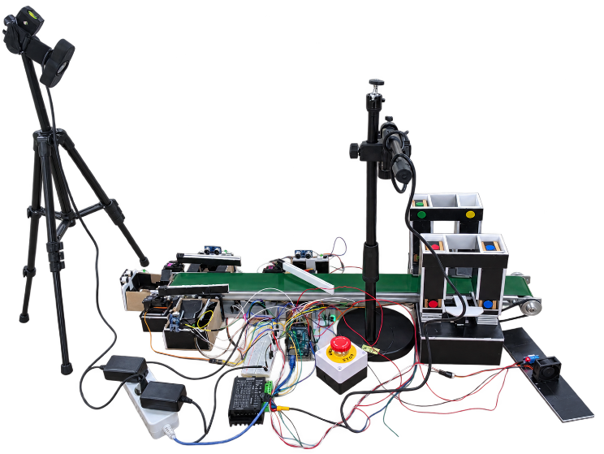
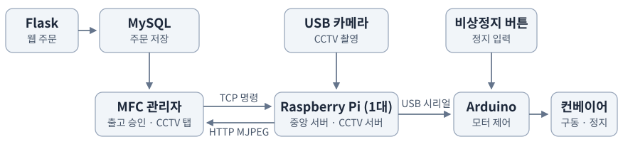
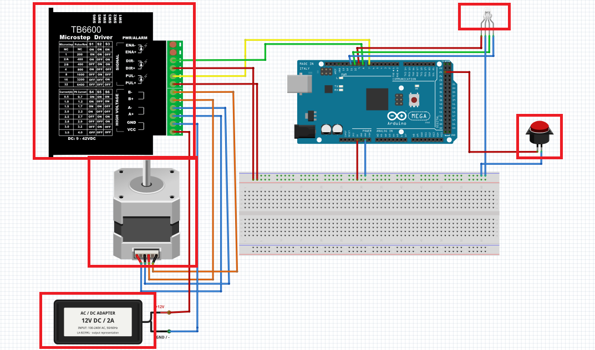
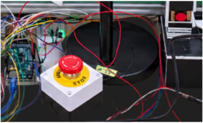
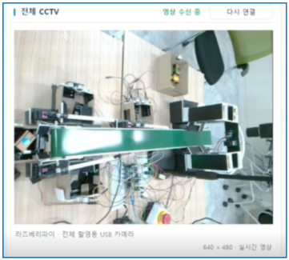

# MobleKurly

MFC 기반 온라인 주문 재고 관리 시스템입니다. 6명이 함께 만든 팀 프로젝트이고, 이 저장소에는 제가 맡은 컨베이어 구동, 비상정지, CCTV 연동 코드만 올렸습니다.


<p align="center">
  
</p>

## 프로젝트 소개

- 기간: 2026.10.16 ~ 2026.10.27
- 인원: 6명 (팀장 1, 웹·DB 2, 하드웨어 3)
- 역할: 부팀장, 하드웨어 담당

웹에서 주문을 받으면 MFC 관리자 프로그램에서 출고를 승인하고, 라즈베리파이와 아두이노가 컨베이어와 서보를 움직여 상품을 옮깁니다.
OpenCV로 상품의 색상 스티커가 주문과 맞는지 검사한 뒤 배송 지역별로 분류하고, 결과와 재고를 MySQL에 반영합니다.

## 시스템 구조

중앙 서버와 CCTV 서버는 **같은 라즈베리파이 한 대**에서 동작합니다. USB 카메라도 이 보드에 직접 연결됩니다.



| 구간 | 방식 | 용도 |
|---|---|---|
| MFC → Raspberry Pi | TCP (5055) | 출고, 정지, 실행 명령 |
| Raspberry Pi → Arduino | USB 시리얼 (115200) | 컨베이어·서보 명령, 상태 응답 |
| Raspberry Pi → MFC | HTTP MJPEG | CCTV 8081, 색 검사 영상 8080 |

## 맡은 부분

### 컨베이어 구동

하드웨어 담당 3명이 같이 컨베이어와 분류부를 만들고, 모터 드라이버, RGB LED, 비상정지 버튼 회로를 구성했습니다.
아두이노에서는 DIR 핀으로 방향을 정하고, `micros()`로 140μs마다 PUL 출력을 바꿔 스텝 모터를 돌립니다.
가동 중에는 LED가 초록, 멈추면 빨강으로 바뀌고, 상태는 시리얼로 라즈베리파이에 보냅니다.

<p align="center">
  
</p>

### 비상정지와 재가동

제어 경로(MFC → TCP → 라즈베리파이 → 시리얼 → 아두이노)는 팀장이 설계했고, 저는 아두이노 쪽 명령 처리와 비상정지를 구현했습니다.

| 명령 | 동작 |
|---|---|
| `!` | 정지 |
| `?` | 상태 조회 |
| `R,<정지번호>` | 실행 (현재 정지번호와 같을 때만) |

버튼을 눌렀다 떼도 컨베이어는 멈춘 채로 있고, MFC에서 새로 실행 명령을 보내야 다시 돕니다.
정지할 때마다 정지번호를 올려서, 그 전에 보낸 실행 요청이 늦게 도착해도 무시하도록 했습니다. 실제 버튼으로는 버튼을 풀어도 멈춘 상태가 유지되고, 새 실행 명령을 보내야 다시 도는 것을 확인했습니다.

```
버튼 누름        → 정지, 정지번호 +1
버튼 뗌          → 계속 정지
예전 번호로 실행  → 거부 (ERR,STALE_START)
현재 번호로 실행  → 재가동
```

<p align="center">
  
</p>

### CCTV 연동

라즈베리파이에서 OpenCV로 USB 카메라 영상을 받아 MJPEG 스트림으로 내보냅니다.
MFC에서는 별도 스레드가 WinHTTP로 스트림을 받아 JPEG 프레임을 잘라 내고, 화면에는 가장 최근 프레임만 GDI+로 그립니다.
CCTV 탭에 들어가면 받기 시작하고, 나가면 멈춥니다. 연결이 끊기면 1.2초 뒤 다시 연결을 시도합니다.

<p align="center">
  
</p>

## 문제 해결

### 비상정지 이후 의도하지 않은 재가동
- **문제**: 버튼 해제를 바로 재가동으로 이어 버리거나 예전 실행 요청을 그대로 처리하면, 사용자가 다시 실행하지 않았는데도 컨베이어가 돌 수 있음
- **해결**: 버튼을 풀어도 정지 상태를 유지하고, MFC에서 새 실행 명령이 와야 재가동. 정지할 때마다 정지번호를 올려 예전 번호의 실행 요청은 거부하고, 버튼이 눌린 동안에는 실행 요청을 받지 않음

### CCTV 영상 수신 중 MFC 화면 응답 지연
- **문제**: 영상 수신을 UI 스레드에서 하면 데이터를 기다리는 동안 화면 갱신과 버튼·탭 조작이 늦어짐
- **해결**: 작업 스레드에서 MJPEG를 받아 JPEG 프레임을 잘라 내고 `PostMessage()`로 화면 갱신만 요청. UI는 최신 프레임만 그리고, 이미 갱신 알림이 대기 중이면 추가 알림은 보내지 않음

## 파일 구성

```
src/
├── mfc/
│   ├── CctvReceiver.cpp / .h   # MJPEG 수신, 프레임 추출, 재연결
│   └── MjpegBuffer.h           # JPEG 프레임 경계 찾기
└── raspberry_pi/
    └── cctv_server.py          # 카메라 영상을 MJPEG로 송출
excerpt/
└── conveyor_estop.ino          # 컨베이어 구동, 비상정지, 상태 LED
```

`excerpt/conveyor_estop.ino`는 팀원들과 같이 쓰던 아두이노 파일에서 제가 짠 부분만 옮겨 온 것이라 이것만으로는 빌드되지 않습니다.

사용 기술: C++, MFC, WinHTTP, GDI+, Python, OpenCV, Raspberry Pi, Arduino Mega

<!-- 시연 영상 링크 넣을 곳 -->
